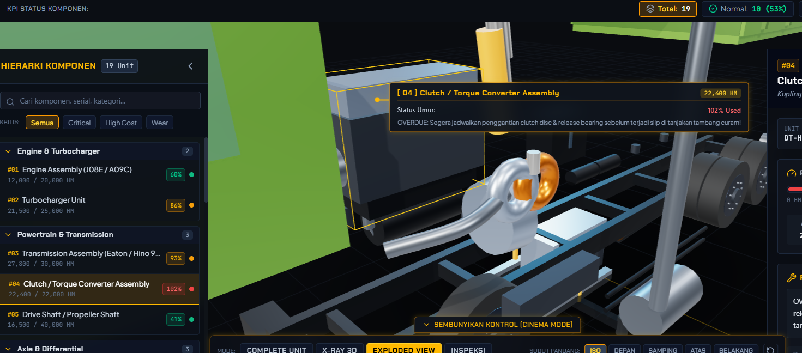

# MINEROZ | HINO 500 Interactive 3D X-Ray & Multi-Unit Mining Fleet Maintenance Explorer

Aplikasi web visualisasi 3D industri pertambangan modern untuk manajemen komponen, pelacakan umur pakai (Hour Meter / HM), monitoring armada dump truck multi-unit, dan perencanaan servis berkala Hino 500 Heavy Duty Tipper.



---

## 🚀 Fitur Utama

- **Interactive 3D X-Ray & Component Inspection:**
  - OrbitControls 360°, Zoom, Pan, dan Preset Sudut Kamera (Front, Side, Top, Rear, Isometric).
  - Mode Tampilan: Complete Unit, X-Ray Wireframe Chassis, Exploded View, dan Component Focus.
  - Bounding Box seleksi dinamis & Technical Connection Line yang otomatis berpindah ke komponen yang dipilih.
  - Dukungan upload model 3D custom (`.glb`/`.gltf`).

- **Multi-Unit Fleet Management (10+ Dump Truck):**
  - Switcher cepat armada dump truck (DT-088 s/d DT-097) langsung dari Header & KPI Dashboard.
  - Status unit operasional: `Running`, `Breakdown`, `Scheduled PM`, dan `Standby`.
  - Filter unit berdasarkan status, pencarian nomor lambung, serta form Tambah/Edit/Hapus unit dump truck.

- **Komponen & Lifetime (HM) Tracking:**
  - 19 komponen kritis pertambangan (Engine, Turbo, Transmission, Clutch, Propeller Shaft, Axle, Hoist, Brake, dll.).
  - Indikator status keausan: Normal (<80%), Warning (80-99%), Overdue (≥100%).
  - Panel histori servis per komponen (Record maintenance, tanggal, teknisi, tindakan perbaikan).

- **Excel & CSV Import / Export:**
  - Download template Excel komprehensif (`.xlsx`) multi-sheet (Unit Fleet & Komponen per Unit).
  - Fitur Import Excel/CSV untuk update massal tanpa perlu input satu per satu.
  - Export data armada saat ini ke format Excel atau CSV.

- **Dark Premium Industrial Design:**
  - Palet warna charcoal & safety yellow khas Mineroz Mining Maintenance Solution.
  - Responsif di desktop, laptop, dan tablet.

---

## 🛠️ Tech Stack

- **Framework:** React 19 + TypeScript + Vite
- **3D Engine:** Three.js (`three`) + OrbitControls
- **Styling:** Tailwind CSS v4 + Lucide React Icons
- **Data & Excel Processing:** SheetJS (`xlsx`)
- **State & Storage:** LocalStorage Persistence untuk seluruh data unit dan histori servis

---

## 📦 Cara Menjalankan Secara Lokal

1. **Clone repository:**
   ```bash
   git clone https://github.com/<USERNAME>/<REPO_NAME>.git
   cd <REPO_NAME>
   ```

2. **Install dependencies:**
   ```bash
   npm install
   ```

3. **Jalankan development server:**
   ```bash
   npm run dev
   ```
   Buka browser di `http://localhost:3000` atau port yang ditampilkan di terminal.

4. **Build untuk production:**
   ```bash
   npm run build
   ```

---

## 📄 Lisensi
Hak Cipta © 2025 MINEROZ Mining Maintenance Solution.
*Right Component • Right Time • Right Cost*
